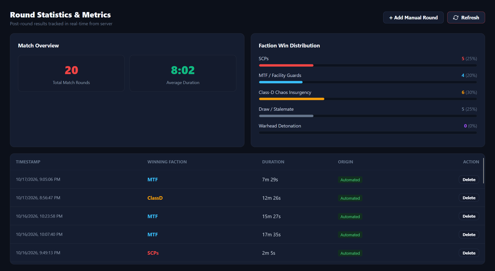
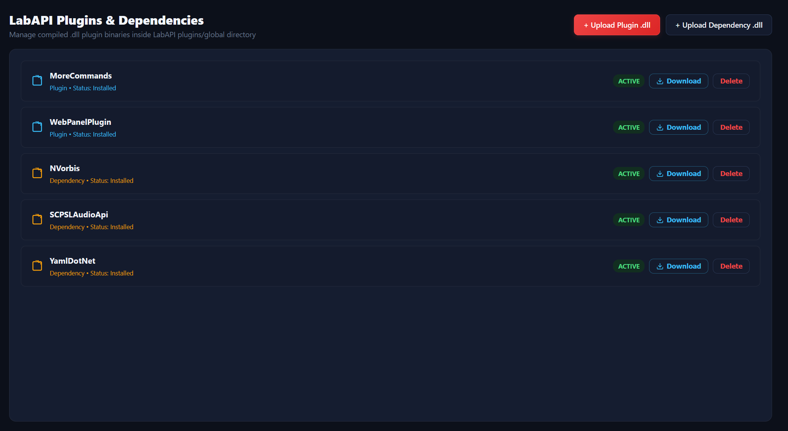

# SCP:SL Web Panel — LabAPI Game Server Plugin (v2.1.1)

[](https://github.com/0MHS/SCPSL-Central-Web-Panel-Plugin/releases)
[](https://dotnet.microsoft.com/)
[](https://github.com/CedModV2/LabAPI)
[](https://scpslwebpanel.zapto.org)
[](LICENSE)

Official LabAPI game server plugin and C# reference source for the **SCP: Secret Laboratory Central Web Panel** ([https://scpslwebpanel.zapto.org](https://scpslwebpanel.zapto.org)).

This plugin establishes an outbound secure TLS Reverse WebSocket tunnel from your dedicated game server directly to the Central Web Panel, allowing real-time browser-based moderation, live console streaming, player management, and telemetry **with zero port-forwarding or firewall changes**.



---

## Overview

The SCP:SL Central Web Panel transforms dedicated server administration into a unified, zero-configuration cloud experience:
- **Zero Inbound Port Forwarding**: The plugin initiates an outbound TLS WebSocket (`ClientWebSocket`) to `wss://scpslwebpanel.zapto.org/ws/plugin`. No public ports or firewall changes are required on your host.
- **Real-Time Memory and Process Telemetry**: Monitor server RAM allocation, CPU usage, tickrate stability, and process status with sub-second responsiveness.
- **Quick Action Controls**: Execute instant server reloads, configuration refreshes, and graceful restarts directly from the interface.
- **Live Tunnel Connectivity**: Persistent heartbeat monitoring with automatic exponential backoff reconnection ensures unbroken communication between the game server and web dashboard.

---

## Comprehensive Feature Matrix

### Telemetry and Live Server Dashboard
The central dashboard provides operators with instant operational visibility:
- **System Metrics**: Live tracking of RAM allocation, process states, and dedicated server uptime.
- **Roster & Activity**: Active player counts, spectator counts, and pending moderation tickets updated in real time.
- **Facility Status**: Quick-action controls for immediate configuration reloads and server restarts without SSH or terminal access.

### Match Telemetry and Round Analytics
Monitor and review match results across rounds with detailed statistics:


- **Post-Round Event Capture**: Automated capture of round start, round end, match duration, and total player participation.
- **Winning Faction Distribution**: Statistical breakdown of winning factions, including SCP, MTF / Facility Guard, and Class-D / Chaos Insurgency victories.
- **Automated Round Logs**: Full timeline logging of critical match milestones, casualty counts, and objective outcomes.

### Steam Intelligence and Teaming Detection
Integrated player profile analytics enhance investigative capabilities:
- **Playtime Detection**: Extracts and analyzes lifetime SCP:SL hours on record from player Steam accounts.
- **Profile Privacy Resolution**: Multi-layer scraper resolves public versus private profiles with browser headers and fallback parsing.
- **Teaming and Collusion Detection**: Undirected graph connected components identify active mutual friend clusters, detecting unauthorized teaming and cross-teaming in progress.

### Moderation, Audit and Remote Administration
Comprehensive tools for game server enforcement and player governance:
- **In-Game Report Queue**: Real-time triage and processing of in-game F1 player reports with one-click actions.
- **Cross-Server Audit Logging**: Immutable trail of administrative actions, staff interventions, and remote command records.
- **Enforcement Suite**: Remote player kicks, customizable temporary bans with quick duration chips, and permanent bans with safety confirmation dialogs.
- **Persistent Voice Mutes**: Automated voice chat mute tracking with auto-expiring timer persistence.
- **File Synchronization**: Bidirectional synchronization with game configuration files, including `UserIdBans.txt` and `UserIDReservedSlots.txt`.

### In-Game Console and Command Streaming
Bidirectional terminal interface for operational command execution:
- **Live Command Execution**: Send Remote Admin and game console commands directly over the WebSocket tunnel.
- **Remote Broadcast Alerts**: Dispatch instant in-game CASSIE voice synthesis and screen broadcast notifications.
- **Real-Time Log Streaming**: Streams live console logs filtered through LabAPI `ServerEvents.CommandExecuted` and log dispatchers with main-thread safety.

### LabAPI Plugin and Dependency Management
Inspect and manage your server modification ecosystem:



- **Remote Plugin Inspection**: View installed LabAPI plugins, version strings, dependencies, and operational load status directly from the web panel.
- **Owner-Exclusive Governance**: Binary uploads and downloads are strictly restricted to verified server owners to safeguard game host environments.

### Granular Role-Based Access Control
Safely delegate operational authority to community staff:
- **Multi-Tenant Team Sharing**: Server owners can invite moderators and administrators via Discord ID.
- **Fine-Grained Permissions**: Restrict permissions per staff member (console execution, kicking, banning, muting, broadcasting, config editing).
- **Credential Protection**: Staff manage the server through their own Discord accounts without ever exposing raw server connection tokens.

---

## Installation & Setup Guide

### Prerequisites
- An **SCP: Secret Laboratory Dedicated Server** (Windows or Linux).
- **LabAPI** (v1.0.0+) installed on your server.

### Step 1: Download & Place the Plugin DLL
1. Download `ScpWebPanelPlugin.dll` from the latest GitHub Release or your Central Web Panel dashboard.
2. Place the file into your game server's global plugin directory:
   - **Linux**: `/home/<user>/.config/SCP Secret Laboratory/LabAPI/plugins/global/ScpWebPanelPlugin.dll`
   - **Windows**: `%appdata%\SCP Secret Laboratory\LabAPI\plugins\global\ScpWebPanelPlugin.dll`

### Step 2: Register on the Central Web Panel
1. Open [https://scpslwebpanel.zapto.org](https://scpslwebpanel.zapto.org) in your browser.
2. Sign in with your **Discord account**.
3. Under the server management dropdown, click **Add Server** (or use your default assigned server).
4. Copy your unique **Server Connection Token** (`scp_...`).

### Step 3: Configure `config.yml`
Open your server port configuration file:
- **Linux**: `/home/<user>/.config/SCP Secret Laboratory/LabAPI/configs/<port>/WebPanelPlugin/config.yml`
- **Windows**: `%appdata%\SCP Secret Laboratory\LabAPI\configs\<port>\WebPanelPlugin\config.yml`

*(If the file does not exist yet, you can create it or start the server once so LabAPI generates the template).*

Paste your configuration:
```yaml
web_panel_plugin:
  is_enabled: true
  central_ws_url: "wss://scpslwebpanel.zapto.org/ws/plugin"
  server_token: "YOUR_SERVER_TOKEN_HERE"
  server_name: "My Awesome SCP:SL Server"
  reconnect_interval_seconds: 5
  max_reconnect_interval_seconds: 60
  stream_console_logs: true
  report_round_stats: true
  report_in_game_reports: true
```

### Step 4: Start or Reload Your Server
Restart your game server or run `reload plugins` in your server console.
Once connected, you will see the following line in your server console:
```text
[INFO] [ScpWebPanelPlugin] [PluginWS] Connected successfully! Sending authentication handshake...
```
In your browser on [https://scpslwebpanel.zapto.org](https://scpslwebpanel.zapto.org), your server status indicator will switch to green (**ONLINE / TUNNEL ACTIVE**), and live player rosters, console logs, and moderation controls will become active immediately!

---

## Security & Privacy
- **Encrypted Transmission**: All communication between your game server and the central panel is encrypted via TLS 1.3 / WSS.
- **Tenancy Isolation**: Each game server is strictly bound to its owner's Discord account and delegated staff.
- **Binary Integrity**: Built with strict argument sanitization protecting `UserIdBans.txt` and preventing remote command injection.

---

## Support & Inquiries
- **Central Web Panel**: [https://scpslwebpanel.zapto.org](https://scpslwebpanel.zapto.org)
- For issues, feature requests, or bug reports, please open an issue on this repository.
