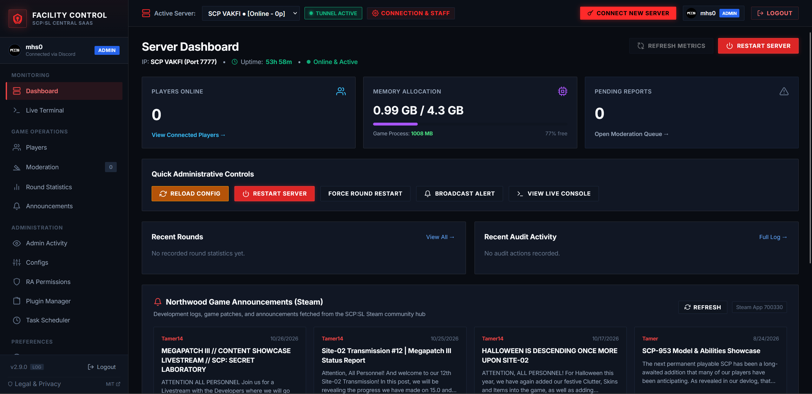
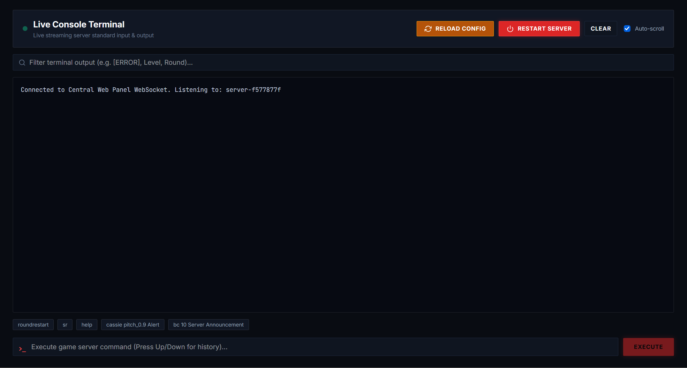
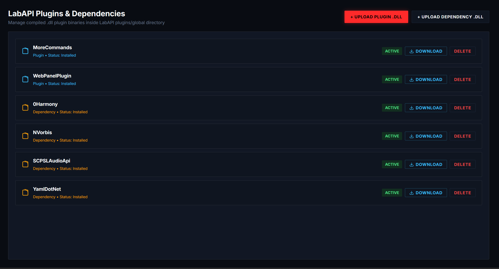

# SCP:SL Central Web Panel — LabAPI Game Server Plugin (v2.2.2)

[](https://github.com/0MHS/SCPSL-Central-Web-Panel-Plugin/releases)
[](https://dotnet.microsoft.com/)
[](https://github.com/CedModV2/LabAPI)
[](https://scpslwebpanel.zapto.org)
[](LICENSE)

> [!NOTE]
> **Disclaimer & Non-Affiliation Notice**: This project is an independent community-developed open-source tool and is **NOT affiliated with, endorsed by, or sponsored by Northwood Studios**. *SCP: Secret Laboratory* and related game assets and marks are the exclusive property of Northwood Studios and the SCP Wiki community (licensed under CC BY-SA 3.0).

An enterprise-grade, zero-configuration cloud administrative, moderation, and telemetry web panel suite designed for dedicated game servers running **SCP: Secret Laboratory** (via the **LabAPI** modding framework).

Connect any dedicated game server to the central cloud panel ([https://scpslwebpanel.zapto.org](https://scpslwebpanel.zapto.org)) simply by dropping `ScpWebPanelPlugin.dll` into your plugins directory and pasting your unique `ServerToken`.



---

## Key Highlights & Server Owner Benefits

### Zero Port Forwarding & Effortless Setup
- **No Modem, Firewall, or Static IP Configuration**: The plugin opens an outbound secure TLS Reverse WebSocket tunnel (`wss://scpslwebpanel.zapto.org/ws/plugin`) directly to the central panel.
- **NAT & Dynamic IP Friendly**: Whether your server is hosted on a local PC or an enterprise VDS, it connects instantly with zero port forwarding, zero Linux daemon tinkering, and zero tmux dependencies.
- **Automatic Exponential Reconnection**: Silent background reconnection (`5s -> 10s -> 20s...`) ensures continuous panel availability without degrading server performance during network interruptions.

---

### Real-Time Game Console, Log Streaming & CASSIE Broadcasts
Manage your game server's live terminal directly through any modern web browser:



- **Bidirectional Live Terminal**: Execute engine and Remote Admin (RA) commands remotely with sub-second WebSocket response times.
- **In-Game CASSIE Announcements & Broadcasts**: Trigger synthesized voice announcements (`cassie`) or flash targeted on-screen broadcast notifications (`bc` / `pbc`) across the facility.
- **One-Click Quick Actions**: Instant server configuration reloading (`reload config`), plugin reloads, and guarded server restart controls.

---

### Teaming & Collusion Detection (Steam Social Graph)
Identify rule violations and unfair alliances automatically:
- **Mutual Friend Cluster Analysis**: Analyzes active players' Steam friendship connections using graph connected components to detect and color-code illicit alliances (cross-teaming) in real time.
- **Steam Profile & Playtime Intelligence**: Automatically inspects total SCP:SL hours on record and flags private profiles using browser-level resolution.
- **Recent Players Memory**: Retains records of recently disconnected players so moderators can investigate and punish rule breakers who disconnect to evade sanctions.

---

### Visual Inventory & Real-Time Player Management
Inspect and moderate active players with an intuitive graphical interface:
- **Visual Inventory Management**: View player equipment rendered with lightweight modern WebP item sprites; give, remove, or modify items, health, and role assignments with single-click actions.
- **Rapid Enforcement Suite**: Execute immediate kicks, customizable temporary bans with quick duration chips (10m, 1h, 1d, 7d, 30d), or permanent bans with destructive confirmation dialogs.
- **Live Countdown Voice Mutes**: Apply voice chat mutes with persistent countdown timers that automatically expire and synchronize with in-game voice permissions.
- **In-Game F1 Player Report Desk**: Triage and resolve player-submitted reports with integrated one-click moderator actions.

---

### LabAPI Plugin & Configuration Manager
Inspect and maintain your server modification environment from the cloud:



- **Installed Plugin Registry**: View all active LabAPI plugins, version numbers, and operational statuses at a glance.
- **Web-Based Configuration Editor**: Edit plugin `config.yml` files directly in your browser and dispatch live in-game reloads (`labapi reload configs`).
- **Owner-Exclusive Governance**: Raw DLL operations and binary downloads are strictly restricted to verified server owners to preserve host security.

---

## Quick Installation Guide

Connecting your dedicated server takes less than 2 minutes:

```
[1. Sign In] -> [2. Connect Server & Get Token] -> [3. Drop DLL into Plugins] -> [4. Paste config.yml] -> [5. Live Tunnel Active]
```

### 1. Download the Plugin Binary
1. Download `ScpWebPanelPlugin.dll` from the latest [GitHub Release](https://github.com/0MHS/SCPSL-Central-Web-Panel-Plugin/releases) or directly from this repository.
2. Place the file inside your server's global plugin directory:
   - **Linux**: `/home/<user>/.config/SCP Secret Laboratory/LabAPI/plugins/global/ScpWebPanelPlugin.dll`
   - **Windows**: `%appdata%\SCP Secret Laboratory\LabAPI\plugins\global\ScpWebPanelPlugin.dll`

### 2. Generate a Server Token
1. Open [https://scpslwebpanel.zapto.org](https://scpslwebpanel.zapto.org) and **Sign In with Discord**.
2. Click **"Connect New Server"** in the top navigation bar, enter a friendly name for your server, and copy the generated **Server Token**.

### 3. Configure `config.yml`
Open your server port configuration file:
- **Linux**: `/home/<user>/.config/SCP Secret Laboratory/LabAPI/configs/<port>/WebPanelPlugin/config.yml`
- **Windows**: `%appdata%\SCP Secret Laboratory\LabAPI\configs\<port>\WebPanelPlugin\config.yml`

*(If the file does not exist yet, you can create it or start the server once so LabAPI generates the template).*

Paste the following configuration:
```yaml
web_panel_plugin:
  is_enabled: true
  central_ws_url: "wss://scpslwebpanel.zapto.org/ws/plugin"
  server_token: "YOUR_UNIQUE_SERVER_TOKEN"
  server_name: "EU Chaos #1"
  reconnect_interval_seconds: 5
  max_reconnect_interval_seconds: 60
  stream_console_logs: true
  report_round_stats: true
  report_in_game_reports: true
```

### 4. Start or Reload Your Server
Start your dedicated game server or execute `reload plugins` / `reload config` in your server console.
You will see the following confirmation in your console logs:
```text
[INFO] [ScpWebPanelPlugin] [PluginWS] Connected successfully! Sending authentication handshake...
```
In your browser on [https://scpslwebpanel.zapto.org](https://scpslwebpanel.zapto.org), your server status will instantly turn **TUNNEL ACTIVE (Green)**!

---

## Security Architecture & Access Control

- **End-to-End TLS 1.3 Encryption**: All communication between game servers and the central panel is secured over TLS 1.3 / WSS protocols.
- **Discord Role-Based Access Control (RBAC)**: Server owners can delegate granular moderation permissions (console access, kicking, banning, muting) to staff by Discord ID without ever sharing the server's `ServerToken`.
- **Zero Password Storage**: The platform stores zero user passwords, relying exclusively on Discord OAuth2 `identify` verification.

---

## Legal Disclaimers & Licensing

- **License**: This project is open-source software licensed under the [MIT License](LICENSE).
- **Northwood Studios Notice**: This project is an independent community development and is **NOT affiliated with, endorsed by, or sponsored by Northwood Studios**. *SCP: Secret Laboratory* is a registered trademark of Northwood Studios.
- **SCP Universe & Creative Commons**: SCP Foundation concepts, lore, and anomalous entries referenced in telemetry are licensed under [Creative Commons Attribution-ShareAlike 3.0 (CC BY-SA 3.0)](https://creativecommons.org/licenses/by-sa/3.0/).

---

## Official Web Panel
Access the live central web panel at: **[https://scpslwebpanel.zapto.org](https://scpslwebpanel.zapto.org)**
